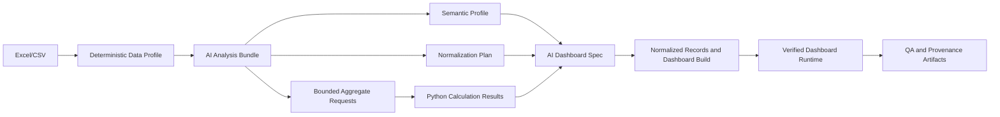

# AI Calculation Workflow

## Purpose

Dashboard Factory uses one workflow for `AI_PROVIDER=local` and
`AI_PROVIDER=groq`. The selected provider plans and reviews analysis; Python
calculates all numeric output locally. The workflow never executes AI-generated
SQL, Python, or JavaScript.

## Flow



The provider receives the same workflow contract and dashboard skill. The user
is responsible for masking or removing sensitive input before importing it.
The current implementation passes metadata, semantic interpretations, bounded
category counts, and local aggregate results to the provider rather than source
files or raw records.

### Two-Pass AI Planning and Cache

The first AI pass returns three related outputs in one strict JSON object:
semantic interpretations, cautious normalization proposals, and up to ten
bounded local aggregate requests. Python validates the plan and calculates the
requested values from the analytical copy. The second AI pass uses those
verified results to design or revise the dashboard specification.

The first-pass artifact is stored at
`output/metadata/ai-analysis-plan.json`. It is reused only when the profile
timestamp, provider, and complete planning instruction match. A changed input,
provider, calculation rule instruction, or user request creates a new plan.
This reduces repeated Local model calls without replacing any analytical AI
judgment with heuristic field mappings.

### Provider Prompt Budget

`AI_PROVIDER=local` receives the full repository workflow excerpts and prompt
guidance because its context limit is controlled by the locally loaded model.
`AI_PROVIDER=groq` receives a compact equivalent planning contract so an online
Groq TPM quota does not reject a specification request before Python can apply
the same deterministic validation. Both providers still receive the same
profile, approved calculation contracts, and bounded aggregate evidence; the
only difference is explanatory prompt length.

Specification generation is a background Factory job. The UI displays its
backend-reported stage and percentage for the bundled AI analysis, local
calculation, and dashboard planning. For Qwen3 and other
reasoning models, the JSON path explicitly disables thinking before generation
so the model returns only the final schema object instead of chain-of-thought
text. `LMSTUDIO_MAX_TOKENS` controls the maximum structured completion length
and defaults to `1024` to keep spec generation fast while still allowing a
complete schema response. Raise it only when a model returns incomplete JSON.

## Calculation Rules

Each project stores rules in `config.json` under `calculation_rules`. The
Factory UI edits these values through the **กฎการคำนวณ** panel.

```json
{
  "current_academic_year_be": 2569,
  "student_id": {
    "field": "รหัสนักศึกษา",
    "entry_year_digits": 2,
    "entry_year_base_be": 2500,
    "program_years": 4,
    "maximum_study_years": 8
  },
  "risk": {
    "gpa_field": "เกรดเฉลี่ย_GPAX",
    "gpa_below": 2.0
  },
  "calculation_instruction": "รหัสนักศึกษาอาจมี u นำหน้า; สองหลักแรกคือปีเข้า"
}
```

For a student ID such as `u6970097`, the configured two-digit prefix and base
produce entry year $2500 + 69 = 2569$. Student year is then:

$$
\text{student year} = \text{current academic year} - \text{entry year} + 1
$$

The value is emitted only when it is from year 1 through the configured maximum
study duration. Invalid or ambiguous IDs remain unclassified and create a
normalization notice.

## Bounded Local Tools

The model may request no more than ten local aggregate calculations. Supported
operations are `count`, `distinct`, `sum`, `average`, `minimum`, and `maximum`.
Each request must name a field from the profile, an optional dimension, and
bounded equality filters. Python validates the request and returns aggregate
values only.

The second AI pass receives these results as evidence when creating or revising
the dashboard specification. This makes Local AI and Groq follow the same
multi-round process while retaining deterministic calculations.

## Data Normalization

Normalization is a two-layer process. Deterministic cleanup trims category
whitespace and handles established safe forms such as gender and education
status. The configured AI provider then proposes a **normalization plan** from
the project's low-cardinality category and date values.

The plan is stored at `output/metadata/normalization-plan.ai.json`. A mapping
is accepted only when its field and exact source value exist in the profile and
the AI reports confidence of at least `0.75`. It cannot automatically map IDs,
names, free text, high-cardinality categories, or numeric measures. Ambiguous
values are warnings, not changes.

Examples of values that may be mapped when the evidence is clear:

- `ชาย`, `ช`, `male`, and `m` -> `ชาย`
- `หญิง`, `ญ`, `female`, and `f` -> `หญิง`
- whitespace or spelling variants of a known status -> the agreed status label
- category aliases found consistently in the same source field

All changes apply only to the analytical copy. Raw input is never modified.
Every source-to-target mapping, reason, affected-row count, and ambiguity is
recorded in `output/reports/transformation-report.md` and surfaced as a QA
notice.

### Date Standard

The profiler detects dates from their values even when a column name is not
explicitly a date. It recognizes Buddhist Era, Gregorian, ISO datetime, Thai
month-name, and English month-name formats. Dashboard date dimensions always
use Buddhist Era year, Thai month, and quarter. For example, `2026-09-30`,
`30 Sep 2026`, and `30 กันยายน 2569` all summarize under year `2569`.

Raw source dates remain unchanged for lineage. Unparseable or ambiguous dates
are not guessed; they appear as a QA/transformation warning.

## Correcting A Dashboard

1. Open the project and update **กฎการคำนวณ** when a field mapping, academic
   year, student-ID format, or risk threshold is known.
2. In **ปรับด้วย AI**, state the correction explicitly: KPI/chart name, source
   field, aggregation, filter, formula, and expected value when available.
3. Select **ส่งให้ AI ปรับ Spec**. The system records the before/request/after
   spec revision, requests fresh local aggregates, and sends those results to
   the AI revision pass.
4. Select **สร้าง Dashboard**. Review
   `output/metadata/calculation-results.json`,
   `output/reports/transformation-report.md`, and `output/qa/qa-report.json`.
5. Do not publish when QA shows a calculation warning until the source mapping
   or formula is corrected.

Example correction:

```text
แก้ KPI นักศึกษาลาออกให้ใช้ COUNT(DISTINCT รหัสนักศึกษา)
โดยกรอง สถานะ = 'ลาออก' และใช้คอลัมน์ เกรดเฉลี่ย_GPAX หา AVG ของกลุ่มนี้
```

## Delivery Phases

### Phase 1: Implemented

- shared Local/Groq planning workflow
- semantic profile and AI-requested bounded local aggregates
- project calculation-rule API and UI
- academic-year, student-ID, and GPAX-risk derived fields
- traceable category normalization, calculation results, and QA artifacts

### Phase 2: Dashboard Runtime Binding - Implemented

- Dashboard build embeds the server-verified unfiltered KPI results produced by
   the local calculation engine. Initial KPI values therefore do not depend on a
   browser-side approximation.
- KPI cards and charts retain their verified formula, aggregation, fields, and
   equality filters as a calculation plan. When a dashboard filter changes, the
   browser applies that same bounded plan to the analytical records and redraws
   the affected KPI/chart.
- The dashboard shows formula and source-field provenance for each KPI/chart,
   allowing a reviewer to compare the visible value to
   `output/metadata/calculation-results.json`.

The runtime accepts only bounded aggregate formulas already supported by the
Factory: `COUNT`, `COUNT(DISTINCT ...)`, `SUM`, `AVG`, `MIN`, and `MAX`, with
equality filters. A formula it cannot parse is not invented in the browser; it
falls back to the server-verified result and is reported through QA. More
expressive calculation contracts belong in Phase 3 rather than unrestricted
browser evaluation.

### Phase 3: Rule Library - Implemented

The Factory UI provides reusable templates for education completion rate,
finance profit, general ratio, and category share. Each template requires
explicit source-field mappings and is first saved as a **draft**. Draft rules
are excluded from AI planning, dashboard calculations, and output artifacts.

An approver must enter their name before a draft can be approved. Approval
records the UTC timestamp, approver, and contract version in
`output/metadata/calculation-rule-versions/`. Approved contracts are available
to the planner only as the exact metric reference `contract:<id>` and are
calculated locally:

- completion rate and ratio: $\frac{\sum numerator}{\sum denominator} \times scale$
- profit: $\sum revenue - \sum expense$
- category share: $\frac{matching\ rows}{all\ rows} \times scale$

The generated dashboard receives only approved contract definitions and
recalculates them when filters change. A zero denominator returns `0`, rather
than an invented or infinite value. In the local Factory, approver identity is
an entered audit value; when a project is published through DataLink, its
authenticated approval/audit workflow remains the organizational authority.

## Verification

1. Create a profile and save calculation rules.
2. Create or improve a spec and inspect `ai-tool-results.json`.
3. Build the dashboard and confirm calculation and transformation artifacts.
4. Save a metric rule as draft, approve it, and confirm an approval snapshot
   is written under `output/metadata/calculation-rule-versions/`.
5. Confirm that incorrect field mappings create QA warnings instead of a
   fabricated number.